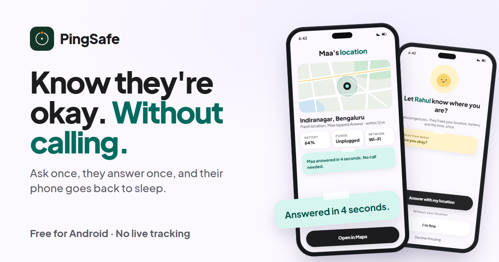
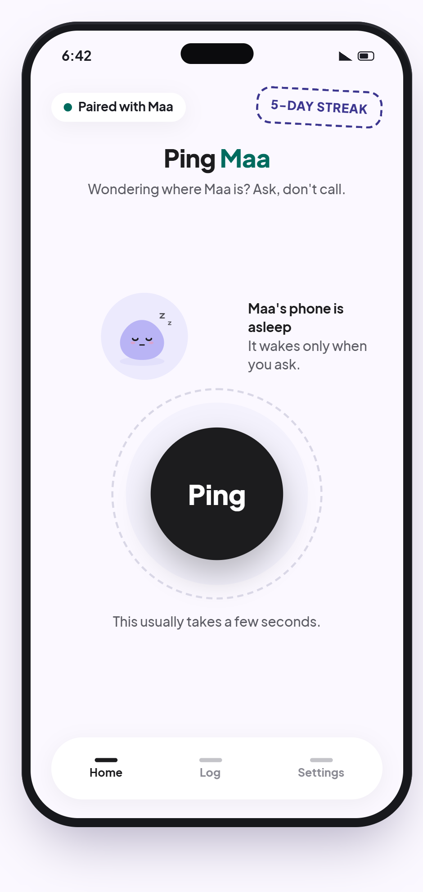
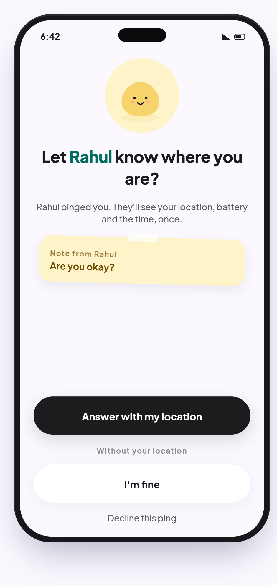
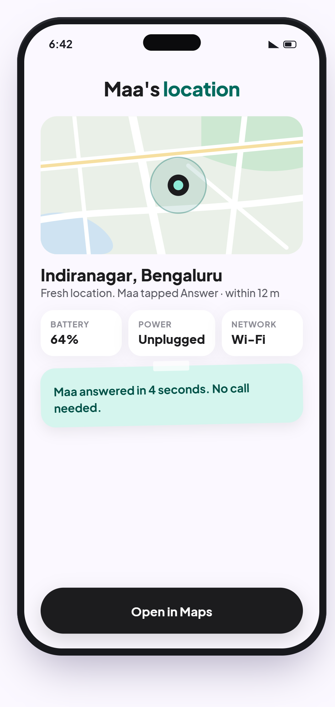
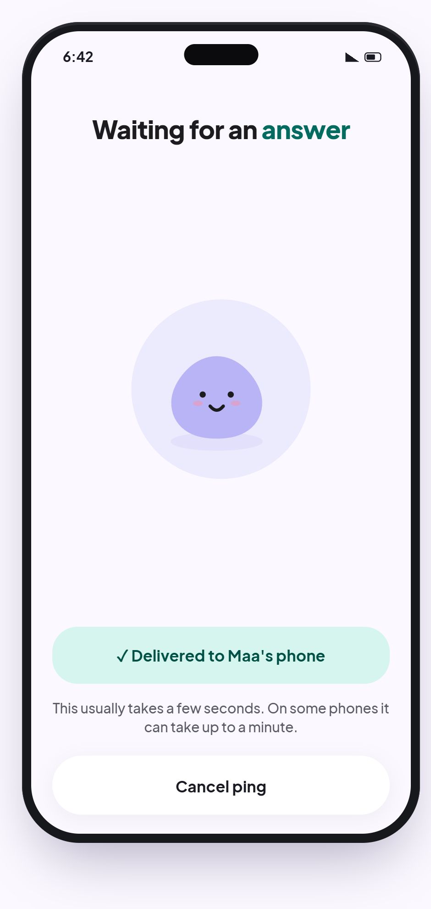
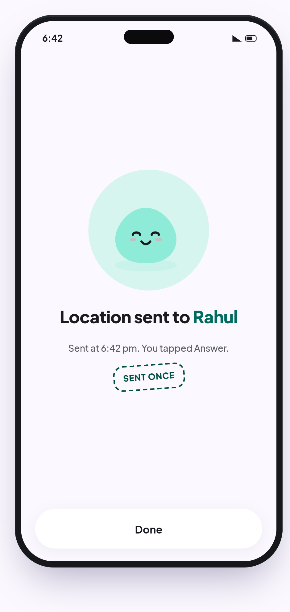
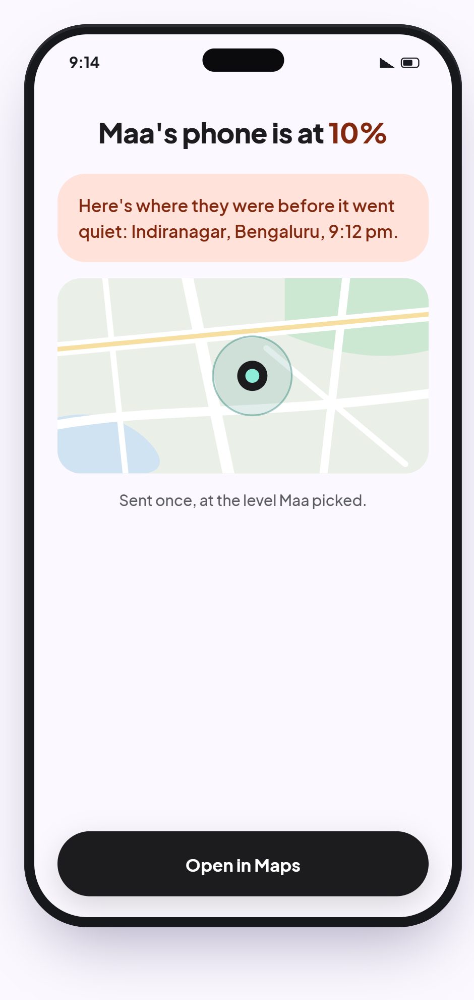
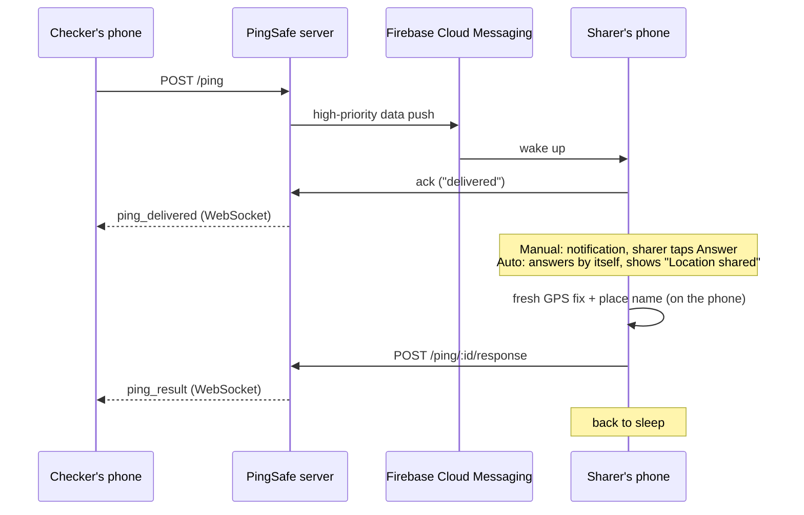

<p align="center">
  
</p>

<h1 align="center">PingSafe</h1>

<p align="center">
  <b>Know they're okay. Without calling.</b><br>
  Ask once. Their phone answers once, then goes back to sleep. No live tracking.
</p>

<p align="center">
  <a href="https://github.com/ramanujdodiya22/pingsafe-releases/releases/latest/download/PingSafe.apk"><b>Download for Android</b></a> ·
  <a href="https://pingsafeapp.github.io">Website</a> ·
  <a href="https://pingsafeapp.github.io/privacy.html">Privacy policy</a> ·
  <a href="https://github.com/ramanujdodiya22/pingsafe-releases/releases">All versions</a> ·
  <a href="https://github.com/ramanujdodiya22/pingsafe-releases/issues">Report a problem</a>
</p>

<p align="center">
  Free · No account · No ads · Android 8 or newer · In testing
</p>

---

## Contents

- [What is PingSafe?](#what-is-pingsafe)
- [How it works](#how-it-works)
- [Features](#features)
- [Privacy promises](#privacy-promises)
- [Install](#install)
- [Questions](#questions)
- [Under the hood (for engineers)](#under-the-hood-for-engineers)
- [What I measured so far](#what-i-measured-so-far)
- [Status and roadmap](#status-and-roadmap)
- [Is the APK genuine?](#is-the-apk-genuine)
- [About this repository](#about-this-repository)
- [Contact](#contact)

---

## What is PingSafe?

When someone you love is late, you call. Then you call again. PingSafe replaces those calls with one tap.

Most family-safety apps share your location **all the time**, in the background. That can feel like being watched,
even by people you trust, and it keeps the phone working all day.

PingSafe does the opposite. It **asks instead of tracks**:

- **You tap Ping.** That's the question: "Where are you? Are you okay?"
- **Their phone wakes up** and answers once: the place, battery, whether it's charging, the network and the time.
- **Then it goes back to sleep.** Location is never read in between. There is no map that follows anyone around.

Two phones take part. The one that asks is the **checker**. The one that answers is the **sharer**. Both install PingSafe.

## How it works

<table>
  <tr>
    <td align="center" width="33%"><br><b>1. You tap Ping</b><br>Optionally add a note like "Are you okay?"</td>
    <td align="center" width="33%"><br><b>2. Their phone wakes</b><br>They answer with one tap, or PingSafe answers for them.</td>
    <td align="center" width="33%"><br><b>3. The answer arrives</b><br>Place, accuracy, battery, power and network. "Open in Maps" for directions.</td>
  </tr>
</table>

<sub>Screens are drawn from the app's own designs. Names and places (Maa, Rahul, Indiranagar) are examples.</sub>

The sharer chooses how their phone answers:

| Mode | What happens | Good for |
|---|---|---|
| **Manual** (default) | A notification appears. Nothing is sent until they tap **Answer**. They can also reply "I'm fine" without location, or decline. | People who want to approve every share. |
| **Auto** | The phone answers by itself, and still shows "Location shared" every time. | Parents who'd rather not fiddle with the phone. |

If anything stops Auto from working (a permission is missing, the battery saver blocks it), PingSafe **falls back to Manual**
and shows the notification instead. A ping is never silently lost.

## Features

<table>
  <tr>
    <td align="center" width="33%"></td>
    <td align="center" width="33%"></td>
    <td align="center" width="33%"></td>
  </tr>
  <tr>
    <td align="center"><b>Delivery receipt</b><br>See when the ping reached their phone.</td>
    <td align="center"><b>They always know</b><br>Every share shows on the sharer's phone.</td>
    <td align="center"><b>Low-battery alert</b><br>One last location before the phone dies.</td>
  </tr>
</table>

- **Ping with a note.** Say why you're asking ("Call me when you can", "Are you okay?", "Text me when you're home") so it doesn't feel like a check-up.
- **"I'm safe" check-in.** The sharer sends their location once, without being asked: "I'm safe", "Reached home", "On my way".
- **Low-battery alert.** Off until the sharer turns it on. They pick a level from 5 to 20% (default 10%). When the battery reaches it, their phone sends its last location **once per charge**. Android has no exact battery trigger for closed apps, so the phone checks about every 15 minutes and the alert may arrive a few percent late.
- **Quiet hours.** Pings pause during sleep or prayers, and the sharer's phone isn't woken. Check-ins and the low-battery alert still go through.
- **Timed pings.** On a long journey, ask every 15, 30 or 60 minutes for up to 12 hours. The sharer is told when it starts, sees every ping and can stop it in one tap.
- **More than a dot.** Battery %, charging, Wi-Fi or mobile data, how fresh the location is and how precise it is (for example "within 12 m").
- **Pair with a link or a code.** Send an invite link on WhatsApp or SMS, or use a 6-digit code. The sharer always approves.
- **Activity log on your phone.** Each phone keeps its own list of the latest 50 shares (when, how and where). It never leaves the phone.
- **Updates inside the app.** PingSafe tells you when a new version is out and installs it after checking the file.

## Privacy promises

PingSafe is built so nobody feels watched.

| Promise | How it's kept |
|---|---|
| **They say yes first** | Nobody is paired until the sharer approves the request on their own phone. |
| **No live tracking** | Location is read only when someone asks (or at the low-battery level the sharer picked). It is never read in between. The only background task is the optional low-battery alert, which checks the battery level, not the location, about every 15 minutes. |
| **They always know** | Every time location is shared, the sharer's phone shows it. |
| **Stop in one tap** | Either person can unpair at any time. Auto mode and the low-battery alert turn off in one tap. |
| **No history on the server** | The server keeps only the **latest** answer, for about an hour, so the checker can reopen it. Records kept for speed stats contain **no coordinates**. |
| **Names stay on the phones** | Nicknames live only on each phone. Notifications are written by the phone itself, so push messages never carry names or places. |
| **No accounts** | No email, no phone number, no sign-up. Each phone gets its own private ID and secret. |
| **No ads, no selling data** | Nothing to buy, nothing to sell. |

Read the full [privacy policy](https://pingsafeapp.github.io/privacy.html).

## Install

PingSafe isn't on the Play Store yet, so Android asks one extra question the first time. It takes about a minute.

1. **Download** [PingSafe.apk](https://github.com/ramanujdodiya22/pingsafe-releases/releases/latest/download/PingSafe.apk) on your Android phone.
2. **Allow the install.** Android asks once: turn on **Allow from this source**, then go back.
3. **Open it and pair.** One person sends an invite link or a 6-digit code. The other approves.

Install it on **both** phones. After that, updates come inside the app (Settings → Check for updates).

**For pings to arrive on time,** let PingSafe run in the background. The app walks you through it:
- Turn off battery optimization for PingSafe.
- On Xiaomi, Redmi and POCO phones, also turn on **Autostart**. Without it, pings can arrive late or not at all.
- For Auto mode and the low-battery alert, allow location **"All the time"**.

## Questions

<details>
<summary><b>Is PingSafe free?</b></summary>

Yes. No account, no ads, nothing to buy.
</details>

<details>
<summary><b>Does it drain the battery?</b></summary>

It's designed to use very little. PingSafe never tracks location in the background. The sharer's phone sleeps until
someone asks, reads its location once, and sleeps again. The only background task is the low-battery alert, and only
if it's turned on: it checks the battery level (not the location) about every 15 minutes.
I'm still measuring this on real phones; see [What I measured so far](#what-i-measured-so-far).
</details>

<details>
<summary><b>Can someone see my location without me knowing?</b></summary>

No. You approve every pairing, your phone shows every time your location is shared, and you can unpair in one tap.
</details>

<details>
<summary><b>What does the other person see?</b></summary>

The place, how precise it is, your battery, whether you're charging, your network and the time.
The server keeps only the latest answer, for about an hour.
</details>

<details>
<summary><b>A ping didn't arrive. What do I check?</b></summary>

On the sharer's phone: turn off battery optimization for PingSafe, and on Xiaomi, Redmi or POCO phones turn on
Autostart. Some phone brands close background apps aggressively, and Google can delay messages to sleeping phones.
PingSafe shows when a ping was delivered, so you can tell "not delivered" from "not answered".
</details>

<details>
<summary><b>Does it work on iPhone?</b></summary>

Not yet. PingSafe is for Android 8 or newer, on both phones.
</details>

<details>
<summary><b>Why isn't it on the Play Store?</b></summary>

PingSafe is in testing. Until it's on the Play Store, you install the file from this page, and the app tells you when
a new version is ready.
</details>

<details>
<summary><b>Is the file safe to install?</b></summary>

It comes straight from this GitHub page and is signed with PingSafe's certificate (see
[Is the APK genuine?](#is-the-apk-genuine)). Android only installs updates signed with the same certificate.
</details>

## Under the hood (for engineers)

The core idea is an **event-driven pull** instead of 24/7 GPS. The sharer's phone does nothing until a push message
wakes it.



**Why a server at all?** Phones have no fixed address on the internet, so they can't reach each other directly.
The server is the go-between: it holds who is paired with whom, asks Firebase to wake the other phone, and passes
the answer back. It's API only, with no web version of the app.

### Design decisions worth knowing

- **Never assume a push arrives.** Google may delay silent pushes to sleeping phones, and some brands kill background apps.
  So the sharer's phone sends an **ack** the moment a push arrives. In Auto mode, if there's no ack within 5 s, or no
  answer soon after the ack, the server sends a **Manual fallback** push with a visible notification.
- **Every push is data-only.** The phone builds the notification text itself with its local nickname, so names and
  places never travel through Google's servers.
- **Precise over fast.** "In an emergency, nearby isn't enough." The phone races its last known position against a
  fresh GPS fix and refines rough fixes. Every answer carries its age, its source (fresh or remembered) and its accuracy.
- **A ping closes exactly once:** answered, "I'm fine", declined or cancelled. Answers are idempotent, so a retry never
  double-counts.
- **No accounts.** `POST /devices/register` returns a device ID and secret. The server stores only a hash of the secret;
  the phone keeps it in Android Keystore-backed encrypted storage. Every request and the WebSocket upgrade are
  authenticated with it.
- **A wiped phone ends its pair.** If Firebase reports that the other phone's app was removed, the server unpairs, so
  nobody stays paired to a phone that no longer exists.
- **Timing on one clock.** Phone clocks aren't synced with the server, so the sharer reports only durations
  (GPS fix, place lookup, upload). The true end-to-end time is measured on the checker's own clock, from tap to result.

### Tech stack

| Part | What it uses |
|---|---|
| Android app | Kotlin 2.4, Jetpack Compose (BOM 2026.09), coroutines, FusedLocationProviderClient, Android Geocoder, WorkManager, OkHttp 5 WebSocket, Retrofit 3, Firebase Cloud Messaging (BoM 35.1). minSdk 26 (Android 8), targetSdk 36. |
| Server | Node.js, Fastify 5, @fastify/websocket 11, ioredis 6 with Upstash Redis, firebase-admin 14 using FCM HTTP v1. Runs in a Docker container from environment variables. |
| Push | Firebase Cloud Messaging only. No Firebase database or Firebase sign-in: PingSafe's own server owns pairing, auth and data. |
| Live updates | WebSocket with server heartbeat, and client reconnect with exponential backoff and jitter. |

### What lives where

| Data | Where | How long |
|---|---|---|
| Who is paired with whom, mode, settings | Server (Redis) | Until unpaired |
| Latest answer (location, battery, network) | Server | About 1 hour |
| Speed stats per ping | Server | Last N pings, **no coordinates** |
| Nicknames | Each phone | On the phone only |
| Activity log (when, how, where) | Each phone | Latest 50, never uploaded |
| Device secret | Phone (encrypted) and a hash on the server | Until the app is removed |

## What I measured so far

Every number here comes with its sample size. These are early observations from my own two test phones, not averages
you should rely on.

**Auto mode, end to end** (from tap on the checker to result on screen). POCO X6 Pro (HyperOS 3.0, Wi-Fi) answering,
OnePlus 9 Pro asking. n = 1 per condition, October 2026.

| Sharer's phone | End to end |
|---|---|
| Screen on | 2.82 s |
| Screen off | 2.25 s |
| Deep sleep (forced Doze) | 2.16 s |
| App swiped away from Recents | 2.64 s |

All four came in under the **3-second goal**. The biggest single step was the server's call to Firebase, not the phone.

**What made the difference:** on the POCO with Autostart **off**, one of two pushes never arrived and the other took
about 19 s. With Autostart **on**, pushes arrived in 1–2 s. That's why the app treats Autostart as a real setup step on
Xiaomi phones.

**Still to measure:** typical (p50) and worst-case (p95) speed over many pings, Wi-Fi vs mobile data, how often Auto falls
back to Manual, how late the low-battery alert fires, and idle battery use over 24 hours compared with an app that
tracks continuously.

## Status and roadmap

PingSafe is in **testing** (version 0.8.x). It works end to end on real phones, and I'm collecting numbers before a
wider launch.

- [x] Pairing with approval, by invite link or 6-digit code
- [x] Manual and Auto modes, with automatic fallback to Manual
- [x] Delivery receipts, "I'm fine", decline and cancel
- [x] Low-battery alert, "I'm safe" check-ins, quiet hours, timed pings
- [x] Always-on test server, and in-app updates from this repository
- [ ] Measure speed and battery on more phones (including Samsung)
- [ ] Google Play release
- [ ] More than one person per phone

## Is the APK genuine?

Every test build is signed with this certificate:

```
SHA-256: 84:FC:4C:68:E8:64:E9:93:D2:BA:C7:25:46:14:BB:8A:06:2C:C0:0E:AF:52:94:AA:8D:3A:0F:91:75:96:23:A5
```

Check a file with `apksigner verify --print-certs PingSafe.apk`. If the SHA-256 is different, don't install it.

Each release also includes `latest.json` with the file's SHA-256. The app checks it before installing an update.

## About this repository

This repository holds PingSafe's **releases** and this documentation. The app checks it for new versions.
The source code is private for now.

- **Download the newest version:** [PingSafe.apk](https://github.com/ramanujdodiya22/pingsafe-releases/releases/latest/download/PingSafe.apk)
- **Older versions and release notes:** [Releases](https://github.com/ramanujdodiya22/pingsafe-releases/releases)
- **Found a bug or have an idea?** [Open an issue](https://github.com/ramanujdodiya22/pingsafe-releases/issues). Please don't post anyone's location or phone number.

## Contact

Made with ♥ by **Ramanuj Dodiya**.
[LinkedIn](https://in.linkedin.com/in/ramanujdodiya) · [ramanujdodiya22@gmail.com](mailto:ramanujdodiya22@gmail.com) · [pingsafeapp.github.io](https://pingsafeapp.github.io)
